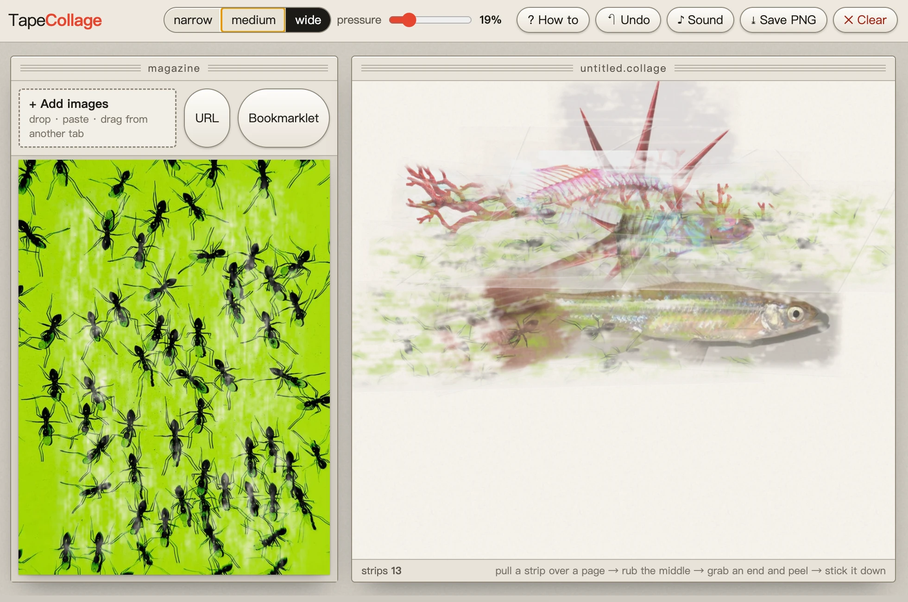

# Tape Collage

**Live site: https://yolaaandaw-dotcom.github.io/tape-collage/**



Press clear tape onto a magazine page, peel it off, and the ink comes away with it, leaving a white
scar on the page. Translucent strips pile up on the board and show through each other.
Pure static HTML: no build step, no audio files.

## Run it

Double-click `index.html`. To grab images from other sites with the bookmarklet, the page needs an http address:

```bash
python3 -m http.server 8790
```

then open http://localhost:8790/ .

## How to play

The first visit shows a four-step tutorial that advances as you do each step ("? How to" in the top bar brings it back).

1. **Put a page in**: drop images on the left (or ⌘V to paste, "+ Add images", "URL").
   Dragging an image straight over from another browser tab works too. The first run comes with eight sample pages (`samples/`).
2. **Lay a strip**: press and drag across a page to pull out a strip (narrow / medium / wide in the top bar). Let go and it is cut off with a snap and pressed down.
   Then **rub back and forth over its middle**: where you have not rubbed there is still air under the tape and it looks milky;
   rubbed areas go clear and press flat. When you peel, only the rubbed areas take the ink (the more you rub, the more comes off).
   The "pressure" slider is how much comes off where you never rubbed (default 25%).
3. **Peel it**: grab a corner near either end (the outer 20%) and **fold it back**. The fold follows the direction you pull
   (pull sideways for a slanted fold, up to 65°), the glue lets go in stick-slip jumps, and the folded part shows the ink mirrored on its sticky side.
   Past halfway the whole strip comes off into your hand. The page keeps a white fibrous scar; a strip laid over a scar later picks up nothing there.
4. **Stick it down**: drag it onto the board on the right and let go. While it is in your hand, the wheel rotates it.
5. **One strip, several pictures**: press a strip in your hand onto any other page and peel again;
   wherever it is not already covered in ink it picks up the new picture (the first layer stays in front, later ones show through the gaps).
6. On the board: drag on empty space = a clear strip (lay it over other strips for a hazy, layered look);
   Shift+drag = tape straight over a strip; wheel on a strip = rotate about its middle; double-click = flip; right-click = bring to front / send to back / crumple;
   `[` `]` rotate; ⌫ crumple; ⌘Z undo.
7. **Save PNG**: exports the board (if a strip uses a hot-linked image from a site that blocks cross-origin reads, it says so; save that image locally and import it instead).

Everything is saved automatically in the browser's IndexedDB, so it survives a reload.

## Grabbing images from other tabs

- Simplest: **drag** an image from another tab into this window, or right-click → copy image, then ⌘V here.
- "Bookmarklet" copies a snippet: make a new bookmark in your bookmarks bar and paste the snippet as its URL.
  On any page, click the bookmark → the page becomes a crosshair → click an image → it shows up here
  (sent straight into an open Tape Collage tab if there is one, otherwise a new one opens). Only works when this page has an http address.

## How it works

- **A strip** is a rotated div; `clip-path` gives it the serrated ends of a dispenser. Inside, stacked: ink layers, the film, creases and trapped air, the highlight.
- **Ink**: each layer is a div with the page as `background-image`, transformed back into page coordinates, under a generated noise `mask-image`:
  blotches + scratches along the strip + feathered edges, so the boundary is soft and a little translucent.
  Each pixel's threshold and feather width come from "pressure": the slider plus how much you rubbed there
  (a strip on a page carries a milky "air" canvas; rubbing erases it). Pressing a strip onto a second page, the new mask is weakened wherever ink already covers the glue,
  and the page's existing scars are punched out of it.
- **Scars**: the same mask, drawn on the page as white paper fibre.
- **Peeling**: the sticker project's pull model (hold / creep / slip / detach, `PEEL_SRC` / `PEEL_BOARD`);
  the fold line follows your pull and the folded part is mirrored with `scaleX(-1)` to show the sticky side.
- **Reflection**: as in the sticker project, a lamp 230px above the desk follows the pointer (and drifts when idle).
  On a flat clear coat its mirror image is a spot right under it: a small hot core and a soft halo. Each frame the lamp's position is
  converted into every strip's own coordinates (`--lx` / `--ly`) and drawn as a CSS radial gradient with `mix-blend-mode: screen`,
  so all strips share one and the same spot whatever their angle.
- **Sound**: all Web Audio synthesis — the buzz of tape coming off the roll, the snap of the cut, pressing it flat, the crackle and release of a peel, the crunch of crumpling.

Files: `index.html` (structure), `style.css` (look and animation), `app.js` (all the logic).
